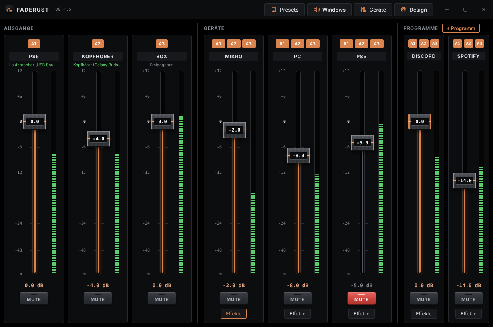
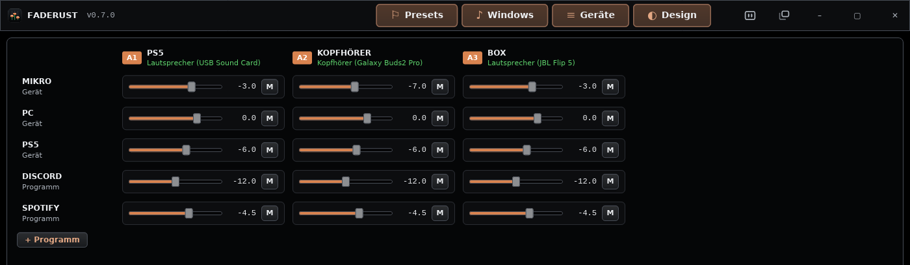
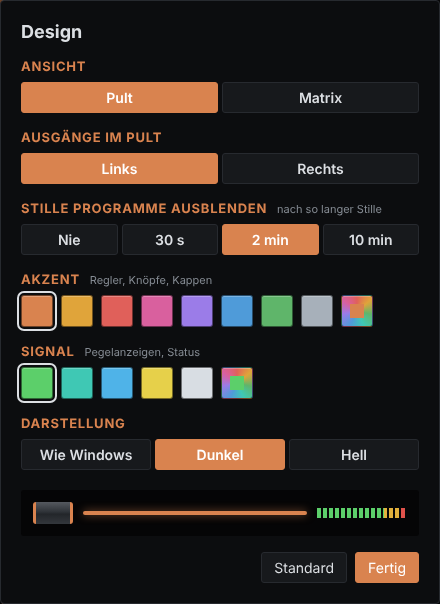

<p align="center"><a href="README.md">English</a> · <a href="README.de.md">Deutsch</a> · <a href="README.fr.md">Français</a> · <a href="README.es.md">Español</a> · <b>Italiano</b> · <a href="README.nl.md">Nederlands</a> · <a href="README.pl.md">Polski</a></p>

<p align="center"></p>

<h1 align="center">Faderust</h1>

<p align="center">
  <a href="https://github.com/Niklas970/faderust/releases/latest"></a>
  <a href="https://github.com/Niklas970/faderust/actions/workflows/ci.yml"></a>
  <a href="LICENSE"></a>
  
  
  <a href="https://github.com/Niklas970/faderust/releases"></a>
  <a href="https://github.com/Niklas970/faderust/stargazers"></a>
  <a href="https://github.com/Niklas970/faderust/commits/main"></a>
  
</p>

<p align="center">
  Mixer audio per Windows, un sostituto leggero e aperto di Voicemeeter.<br>
  Ogni uscita ha il proprio mix, i dispositivi possono andare e venire durante l’uso e Faderust porta con sé i propri cavi virtuali.
</p>



<p align="center">
  <a href="assets/faderust-reel.mp4"></a><br>
  <sub>Anteprima, <a href="assets/faderust-reel.mp4">video in piena qualità</a> (da scaricare)</sub>
</p>

> **Alfa.** Faderust funziona, ma è stato provato a malapena su hardware reale. Segnala i problemi come [issue](https://github.com/Niklas970/faderust/issues).

## Cosa fa Faderust

- **Un banco come Voicemeeter.** Ogni dispositivo e ogni programma ha una striscia con fader, MUTE e i pulsanti A1, A2, A3 per le uscite. Ogni uscita ha il proprio fader master.
- **Matrice per il lavoro di fino.** In alternativa come tabella: ogni ingresso regolato singolarmente su ogni uscita, ad es. il microfono più basso nelle cuffie che nello stream.
- **Cattura i programmi direttamente.** Discord, Spotify o il browser hanno una propria striscia con effetti, senza un cavo virtuale per programma. Faderust nasconde i programmi silenziosi e li riporta singolarmente su richiesta («N silenziosi, mostra»).
- **Cavi virtuali propri, nessun driver aggiuntivo.** L’app configura da sola il «Faderust Kabel» (fino a quattro), ad esempio uno per il microfono e uno per i programmi. Dettagli in [Faderust Kabel](#faderust-kabel).
- **In ordine.** Le uscite si possono nascondere con la × e tornano da sole appena riprende a suonare qualcosa.
- **I dispositivi vanno e vengono.** Spegnere e riaccendere le cuffie Bluetooth, scollegare un dispositivo USB: Faderust si riconnette senza interrompere gli altri dispositivi.
- **Adatto al multipoint.** Faderust libera le uscite Bluetooth durante il silenzio (dopo 30 s, impostabile per uscita) così le cuffie possono passare al telefono. Quando torna il suono, si riaprono da sole.
- **Effetti per ingresso:** riduzione del rumore ([RNNoise](https://jmvalin.ca/demo/rnnoise/), contro tastiera e ventola), filtro passa-alto, equalizzatore a tre bande e gate. La riduzione del rumore funziona sui dispositivi a 48 kHz e ritarda il suono di 10 ms.
- **Tedesco e inglese.** La lingua segue Windows e si cambia in «Design».
- **Le impostazioni si salvano da sole.** La finestra dei dispositivi applica le modifiche poco dopo l’ultimo inserimento.
- **Autotest.** In «Dispositivi» Faderust controlla dispositivi, buffer, retroazione, controllo remoto e plugin Stream Deck e mostra cosa va bene e cosa no. Il rapporto si può copiare per un issue.
- **Il suono di Windows in un unico posto:** dispositivi predefiniti per riproduzione, registrazione e chiamate, più il volume per dispositivo.
- **Preset, avvio automatico nell’area di notifica, aggiornamenti nell’app** (con verifica della firma) e un **plugin Stream Deck**.
- **Compatto e in primo piano.** Due pulsanti nella barra del titolo: vista stretta senza etichette e «Sempre in primo piano», ad es. accanto a un gioco. Entrambi vengono ricordati.
- **Colori personalizzati:** colore di accento e di segnale a scelta, scuro (nero OLED) o chiaro.

## Viste

<table>
  <tr>
    <td width="68%"></td>
    <td></td>
  </tr>
  <tr>
    <td><b>Matrice:</b> ogni ingresso su ogni uscita singolarmente, ad es. il microfono più basso nelle cuffie che nello stream.</td>
    <td><b>Design:</b> banco o matrice, lato delle uscite, colori, scuro o chiaro.</td>
  </tr>
</table>

## Installazione

1. Scarica `Faderust_*_x64-setup.exe` da [Releases](https://github.com/Niklas970/faderust/releases/latest) e avvialo. Il programma di installazione non richiede diritti di amministratore e parla tedesco o inglese.
2. Il programma di installazione non è firmato, quindi Windows SmartScreen avvisa: «Ulteriori informazioni» → «Esegui comunque».
3. Apri Faderust dal menu Start. L’app segnala le nuove versioni in alto nella barra del titolo; un clic sul numero di versione le cerca subito.

Requisito: Windows 10 (dalla versione 2004) o Windows 11.

## Primi passi

1. Apri **Dispositivi** e crea ingressi (microfono, line-in, Faderust Kabel) e uscite (cuffie, altoparlanti, stream). Il Bluetooth richiede circa 80 ms di buffer, l’USB di solito da 30 a 60 ms.
2. Nel **banco** scegli con A1–A3 dove suona un ingresso. Il fader regola insieme tutte le uscite attivate.
3. Usare i fader: trascinare, rotellina del mouse (più preciso con Maiusc), doppio clic per 0 dB, oppure fare clic sul valore in dB sotto e digitare un numero.
4. **Effetti** sotto una striscia apre filtro passa-alto, equalizzatore e gate.
5. In **Design** si passa tra banco e matrice e si scelgono il lato delle uscite e i colori.

### Programmi

**+ Programma** nel banco mostra tutti i programmi che stanno riproducendo audio. **+ Ingresso** ne cattura uno direttamente. Per non sentirlo due volte, Faderust sposta prima il programma su un Faderust Kabel libero che non ascolti (se configurato) e poi lo cattura. Un programma al momento silenzioso viene nascosto da Faderust; **N silenziosi, mostra** lo riporta.

### Microfono per Discord, Teams & co.

In **Dispositivi**, **+ Microfono programma** crea un’uscita su un Faderust Kabel libero che porta solo il microfono con i suoi effetti. Nel programma scegli come microfono il lato di registrazione dello stesso cavo. Faderust silenzia le retroazioni (un’uscita suona sul cavo da cui proviene un ingresso) e mostra «Loop».

### Faderust Kabel

Il Faderust Kabel è un dispositivo audio USB virtuale (stereo, 48 kHz, 24 bit) che Faderust mette a disposizione da sé. Faderust lo mostra come «Faderust Kabel (Riproduzione)» e «Faderust Kabel (Registrazione)»; ciò che un programma riproduce sul lato riproduzione esce di nuovo dal lato registrazione.

1. In **Dispositivi** → **Faderust Kabel** fai clic su **Configura** (una sola volta, con una richiesta di amministratore). Faderust scarica [usbip-win2](https://github.com/vadimgrn/usbip-win2), verifica il checksum e lo installa in background. Non compare separatamente nell’elenco app di Windows.
2. Attiva **Faderust Kabel** e scegli il numero (da 1 a 4), ad esempio uno per il microfono e uno per i programmi. Windows li mostra nelle sue impostazioni come «Faderust Cable», «Faderust Cable 2» e così via.
3. **Rimuovi** annulla la configurazione, usbip-win2 compreso.

Nota: il cavo è ancora un esperimento ed è stato provato su poco hardware.

## Limiti

- I programmi ricordano fader, uscite ed effetti finché la loro striscia resta nel banco: se Discord si riavvia, torna con le vecchie impostazioni. Se rimuovi la striscia in «Dispositivi», vanno persi.
- Nessun driver kernel proprio. I cavi virtuali («Faderust Kabel», fino a quattro) sono dispositivi audio USB che Faderust fornisce tramite USB/IP. Windows usa per questo il suo driver audio USB integrato; la parte USB/IP è [usbip-win2](https://github.com/vadimgrn/usbip-win2) (BSD-2, firmato da Microsoft), che la configurazione installa una sola volta.
- Windows fornisce l’audio per programma, non per scheda del browser o app web. Tutto ciò che viene da un browser passa per lo stesso processo audio.
- Dopo un rilascio il Bluetooth impiega circa un secondo prima che torni il suono. Chi non lo vuole imposta l’uscita su «Mai rilasciare».
- L’associazione «programma → dispositivo» usa la stessa interfaccia Windows non documentata del mixer del volume nelle impostazioni.

Impostazioni: `%APPDATA%\io.github.niklas970.faderust\config.toml`, accanto il registro `faderust.log`, utile in caso di errori.

## Sviluppo

Rust per il nucleo audio e l’interfaccia ([iced](https://iced.rs), senza WebView2).

| Percorso | Contenuto |
|---|---|
| `crates/engine` | Nucleo audio: dispositivi (WASAPI tramite cpal), buffer circolari, compensazione della deriva, matrice di mix, effetti, cattura dei programmi |
| `crates/usbcable` | Faderust Kabel: dispositivo audio USB virtuale tramite USB/IP |
| `crates/core` | Logica dietro l’interfaccia: configurazione, dispositivi, programmi, cavi, controllo remoto, aggiornamenti |
| `crates/gui` | Il programma `faderust`: finestra iced, area di notifica, avvio automatico |
| `streamdeck` | Plugin Stream Deck |

Requisiti: Rust (stable); Node.js per il plugin Stream Deck.

```sh
cargo test
cargo run --release -p faderust
```

- Creare il programma di installazione: `makensis` con `installer/faderust.nsi` (i parametri sono all’inizio del file). Le release nascono dal workflow «Release».
- Engine senza interfaccia: `cargo run --release -p faderust-engine --example mixer -- --list`

Prima di un commit: `cargo fmt`, `cargo clippy -- -D warnings`, `cargo test`. Le nuove dipendenze richiedono una licenza permissiva (`cargo deny check`).

## Stream Deck

Il plugin in [`streamdeck/`](streamdeck/README.md) controlla Faderust dall’Elgato Stream Deck: fader con manopola o tasto, muto, preset e dispositivo predefinito di Windows. Fai doppio clic su `com.niklas970.faderust.streamDeckPlugin` da [Releases](https://github.com/Niklas970/faderust/releases) (Stream Deck 7.1 o successivo). Da lì in poi il programma di installazione include il plugin: in «Dispositivi» Faderust mostra se è disponibile una versione più recente del plugin e la apre con un clic nel software Stream Deck, che chiede solo conferma.

## Licenza

[MIT](LICENSE)
